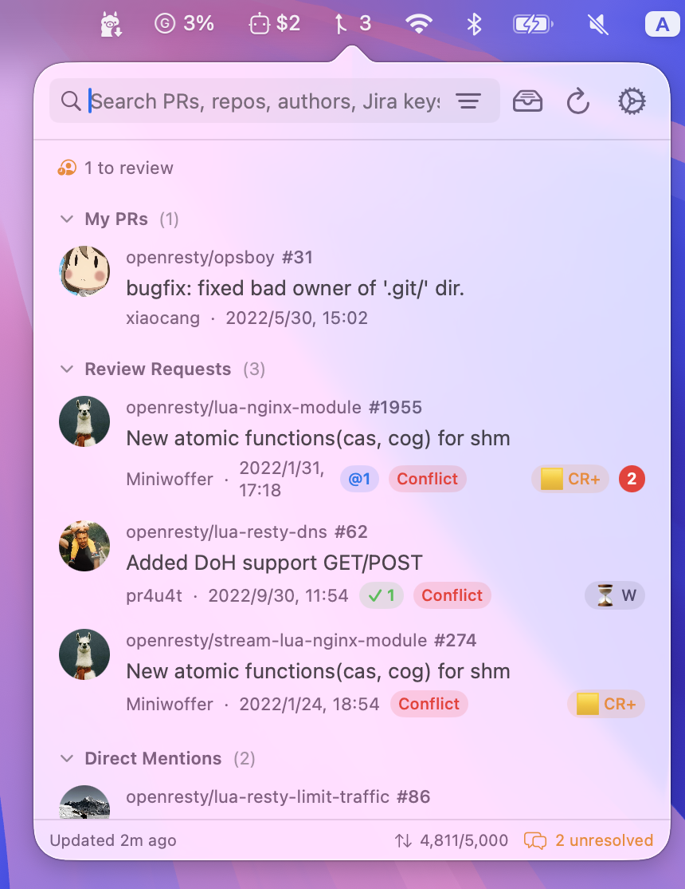
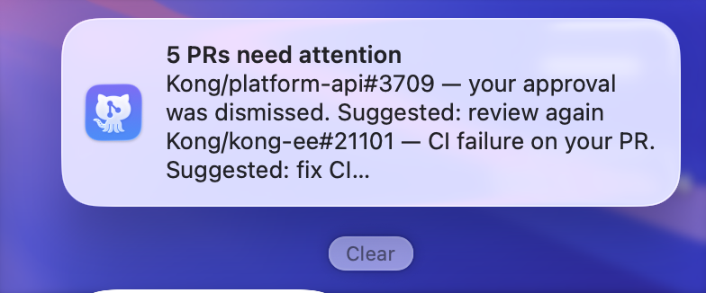
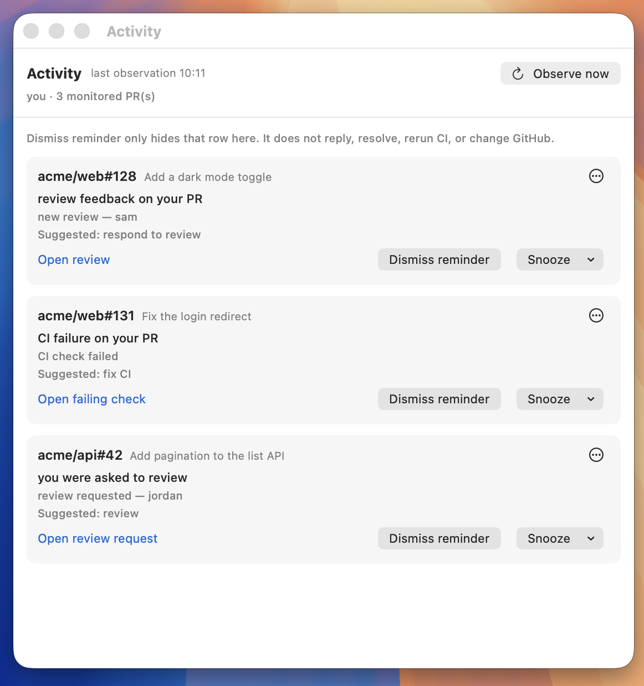

# PR Dashboard

> This repository is for PR Dashboard release downloads only. It does not contain the application source code.

A Mac menu bar app for the GitHub pull requests that involve you.

Open the icon next to the clock. You see PRs you opened, PRs waiting on your review, and PRs that mention you, without keeping a GitHub tab open. Leave it running and it sends at most one short reminder when a review, a comment, or a failing check actually needs you.

It does not replace GitHub, and it is not a bot on GitHub's servers. You still review, comment, and merge there. This app reads and reminds. It changes GitHub only when you click.

The app is **PR Dashboard**. The local command is `ghpr`.




## Highlights

**Your PRs, next to the clock.** Authored PRs, review requests, and mentions in one popover. CI and unresolved comments show on the row.

**A reminder only when it matters.** The first look at a PR is silent, so an old backlog is not replayed as news. After that, at most one digest every 30 minutes, and only when something new needs you. It can go to a Mac notification, a Slack DM to yourself, or both. Activity says why each item concerns you. Dismiss, snooze, and mute affect the reminder only. The app does not review, comment, or rerun CI for you, and it only watches while this Mac is awake and the app is running.





**It stays on this Mac.** There is no account on our side. If you want the same list somewhere else, a userscript can add a small ghpr menu on a GitHub PR page, and the local `ghpr` command can answer a coding agent. Neither one submits a review to GitHub.

## Install

```bash
brew install xiaocang/tap/prdashboard
```

Or download the latest [release](https://github.com/xiaocang/ghpr-view/releases), unzip it, and move `PRDashboard.app` to Applications. The first open may need a right-click → Open.

No Dock icon, unless you open Activity or Settings.

## Sign in

Click the menu bar icon, then **Sign in with GitHub**, and enter the code at [github.com/login/device](https://github.com/login/device).

If that is blocked, use a [personal access token](https://github.com/settings/tokens) with `repo`, `read:user`, `workflow`, and `read:org`. A release build keeps it in the Keychain.

Left-click opens the list. Right-click opens the menu, including Quit. **Cmd+R** refreshes. The gear is Settings.

## Requirements

macOS 13 or later, and a GitHub account. The interface is in English and Simplified Chinese.

## License

Apache License 2.0. See [LICENSE](LICENSE).
